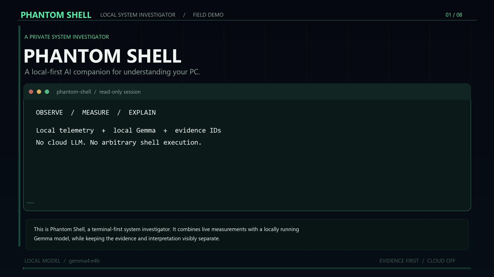

# PHANTOM SHELL

**A local-first AI investigator for Windows system health.** PHANTOM SHELL samples system metrics, detects configured anomalies, and asks a locally running Gemma model to interpret bounded evidence. Measured facts, model hypotheses, and fictional narration are displayed separately.



[Watch or download the narrated project demo](artifacts/phantom-shell-demo.mp4) · [Captions](artifacts/phantom-shell-demo.srt)

## Highlights

- **Local inference:** Ollama is restricted to a loopback endpoint. There is no cloud model or fallback.
- **Live diagnostics:** CPU, memory, system-disk usage, uptime, and bounded process metadata.
- **Rule-based detection:** CPU, memory, low disk space, and process memory growth.
- **Evidence-grounded reports:** hypotheses must cite evidence IDs collected for that investigation.
- **Read-only safety boundary:** deterministic Python routing and a small tool allowlist; no shell execution or system-changing tools.
- **Local history:** SQLite-backed events and investigations with configurable retention.
- **Terminal experience:** atmospheric mode, plain mode, and optional fiction-labeled Story Mode.

## Requirements

- Windows 10 or 11
- Python 3.11 or later
- [Ollama for Windows](https://ollama.com/download)
- A Gemma model already available in Ollama

The default model tag is `gemma4:e4b`, which was used for the verified end-to-end run. PHANTOM SHELL never downloads a model automatically. If you use a different installed Gemma tag, set it in the configuration file.

## Quick start

Open PowerShell in the project folder:

```powershell
py -3 -m venv .venv
.\.venv\Scripts\Activate.ps1
python -m pip install --upgrade pip
python -m pip install -e .
ollama list
phantom doctor
phantom status
phantom ask "What is using my memory?"
```

`phantom doctor` checks the local Ollama service and the exact configured model tag. Start Ollama before running an investigation. If the model tag differs, use `phantom config init` and edit `%USERPROFILE%\.phantom-shell\config.toml`.

## Commands

| Command | What it does |
| --- | --- |
| `phantom` | Startup checks, status snapshot, and continuous monitoring |
| `phantom doctor` | Check Ollama and the configured local model |
| `phantom status` | Show current CPU, memory, disk, and uptime measurements |
| `phantom processes --limit 15` | List bounded process metadata, sorted by memory |
| `phantom scan` | Collect one telemetry sample and evaluate anomaly rules |
| `phantom watch` | Monitor continuously; Ctrl+C stops cleanly |
| `phantom demo-fixture` | Show synthetic anomalies labeled `TEST SCENARIO`; not saved as real findings |
| `phantom ask "What is using memory?"` | Collect relevant evidence and request a local model assessment |
| `phantom events --limit 20` | List recent anomaly history |
| `phantom event <event-id>` | Inspect an event and its evidence |
| `phantom investigations` | List saved investigations |
| `phantom investigation <id>` | Show a saved investigation |
| `phantom story on` / `phantom story off` | Enable or disable fictional narration for future investigations |
| `phantom story event <event-id>` | Narrate a selected event as fiction |
| `phantom config` | Show effective settings |
| `phantom config init` | Create a sample config without overwriting an existing file |
| `phantom clear-history` | Delete local events, investigations, and preferences |

Add `--plain` for non-colored output, for example `phantom --plain status`.

## Configuration

The default configuration path is `%USERPROFILE%\.phantom-shell\config.toml`. You can also pass `--config <path>` or set environment overrides such as `PHANTOM_MODEL` and `PHANTOM_POLL_SECONDS`.

```toml
[phantom]
ollama_url = "http://localhost:11434"
model = "gemma4:e4b"
poll_seconds = 5
cpu_threshold = 85
cpu_consecutive_samples = 3
memory_threshold = 90
disk_free_threshold = 10
process_memory_delta_bytes = 262144000
history_retention_days = 30
log_level = "WARNING"
story_mode = false
plain_mode = false
timeout_seconds = 90
```

Only loopback Ollama hosts (`localhost`, `127.0.0.1`, or `::1`) are accepted. The inference request uses an 8,192-token context and a bounded output budget to fit the tested local GPU configuration. A malformed structured response gets one concise retry; evidence-ID validation remains strict.

## What PHANTOM SHELL collects

The app reads CPU and memory utilization, system-drive usage, uptime, and a bounded process snapshot containing process name, PID, CPU, resident memory, and executable basename when available. It does not read process command-line arguments, files, browser history, passwords, or keystrokes. Windows permission limits and processes exiting during a sample can make fields unavailable.

Telemetry, prompts, investigation results, and history stay local. SQLite and rotating logs are stored under `%USERPROFILE%\.phantom-shell\`. Logs omit prompts and raw telemetry payloads. After installation and model setup, inference uses the local Ollama service; the app has no hosted LLM fallback.

## Evidence and safety

- Python collects observations before inference and selects from a fixed set of read-only tools.
- The model cannot create tools, choose executable shell commands, or directly change system state.
- Findings show measured facts separately from hypotheses. A hypothesis without a collected evidence ID is rejected.
- Model confidence is an uncalibrated label, not a probability or proof.
- Story Mode is explicitly labeled `FICTION` and is separate from diagnostic results.
- If inference fails or evidence is insufficient, the investigation reports an inconclusive result rather than inventing facts.

## Architecture

```text
Rich CLI
  -> validated configuration
  -> psutil telemetry and deterministic threshold detectors
  -> bounded, ID-tagged evidence packet
  -> deterministic Python tool router (maximum 3 calls)
  -> loopback-only Ollama / local Gemma
  -> schema and evidence-ID validation
  -> facts, hypotheses, and recommendations in separate UI sections
  -> local SQLite history
```

The MVP uses a straight-line Python workflow rather than LangGraph: the model does not select tools, so a graph would add orchestration without widening the current capabilities. Module boundaries and trust limits are documented in [docs/architecture.md](docs/architecture.md).

## Development and verification

```powershell
python -m pip install -e ".[dev]"
python -m pytest
python -m build --no-isolation --outdir dist
```

The automated suite covers telemetry, detectors, configuration, evidence validation, storage, CLI behavior, and safety boundaries with stubbed model responses. A real end-to-end investigation was also completed with the preinstalled `gemma4:e4b` model. Local inference latency depends on hardware and model load.

## Scope

This is a Windows-first MVP, not endpoint protection software. Windows Event Log ingestion, trained personal baselines, Linux/macOS support, remote access, a GUI, and automatic remediation are outside the current scope. The app does not claim to detect malware or supernatural activity.

## License

PHANTOM SHELL is released under the MIT License. See [LICENSE](LICENSE) and [LICENSES.md](LICENSES.md) for runtime, dependency, and model-license notes.
